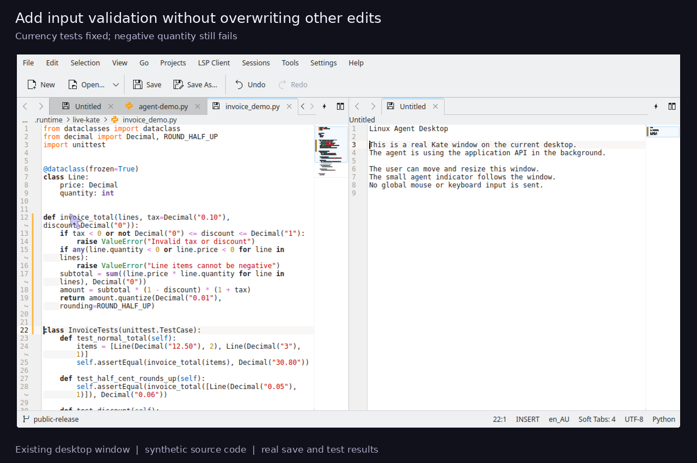

# Linux Agent Desktop

A local, provider-neutral desktop automation service and MCP bridge for Claude
Code and Codex. It operates dedicated applications in background sessions and
reports the limits of each backend instead of claiming universal desktop access.

**Experimental.** Already-running native Wayland and Wine/Xwayland windows can
be attached in an explicitly enrolled, dedicated Sway session. Input uses that
session's seat and capture reads its visible region. This is not universal host
desktop access. See [Sway attachment and boundaries](docs/sway-attachment.md).
The separate live Revu adapter remains a short-lived test-document integration.

## Implemented

- Private X11 sessions: Qt input and screenshots; GTK accessibility through AT-SPI.
- Private KWin/Wayland sessions: clicks, keyboard input, scrolling, dragging,
  window capture, fractional scaling and two virtual outputs.
- Owned headless Chromium: CDP input, screenshots and dialogs with a fresh profile.
- Stable targeting, per-task ownership/locking, cancellation, timeouts, action
  deduplication, durable metadata-only results and crash recovery.
- Operator-selected Sway attachment: stable window identity, text/shortcuts,
  pointer input, visible capture and floating-window move/resize through MCP.
- A read-only observer with an animated cursor, click rings and drag trails.
  Its pointer is separate from the user's pointer.
- A shared MCP interface and skills for Claude Code and Codex.

The private compositor's own focus can change. It does not connect input to the
user's compositor. Covered coordinate targets are rejected; supported semantic
GTK actions can operate under a covering window. Read the
[capability matrix](docs/conformance.md) before choosing a backend.

## Quick start

The full desktop suite was tested on Ubuntu 26.04 with KDE/KWin 6.6.6. Required
system components include Python 3.12+, PyQt6, GI/GTK3/AT-SPI, D-Bus, Xvfb,
KWin, kscreen-doctor, libei and Chrome/Chromium. Some backends need only a subset.
The bootstrap script also requires `uv` and Debian packaging tools.

```sh
git clone https://github.com/aShanki/linux-agent-desktop.git
cd linux-agent-desktop
./scripts/bootstrap.sh
.venv/bin/lad --observer-port 8765 serve
```

In another terminal:

```sh
.venv/bin/python scripts/demo.py
.venv/bin/python scripts/conformance.py --rounds 3
```

Open the private URL printed by the demo to view its cursor. Do not publish that
URL: its fragment is a local viewing capability. Runtime files and profiles stay
in ignored directories and must not be committed.

See [client configuration and usage](docs/usage.md),
[architecture](docs/architecture.md), [validation](docs/validation.md),
[contributing](CONTRIBUTING.md), and [security boundaries](SECURITY.md).

## Evidence and limits

The initial expanded implementation passed three runs of 28 regression cases.
Separate Kate and LibreOffice Writer smoke checks verified exact saved scratch
text and native captures at 1.5× on two virtual outputs. Reports include scope
and source fingerprints; they do not establish support for every application.
The release cleanup adds tests for explicit live-adapter configuration; current
results are in [the conformance report](artifacts/conformance.json).

No credential, personal profile, private-document screenshot or unrelated
desktop capture is distributed with this repository. Demo media contains only
synthetic source code. The service is not a security
sandbox against other processes running as the same operating-system user.

## Live desktop demo

[Watch the Kate demo](artifacts/demo-kate.mp4) ·
[Implementation notes and limits](docs/live-cursor.md)



The clip records a normal desktop Kate window edited through AT-SPI and its
application API, with a real save and five passing program tests.
This older demo uses a separate application-specific route. General Sway
attachment uses the operator enrollment described above. The cursor is a separate, click-through indicator; it is hidden
when idle and tracks window movement and resizing.

## License

[MIT](LICENSE). Third-party runtime dependencies retain their own licenses.
